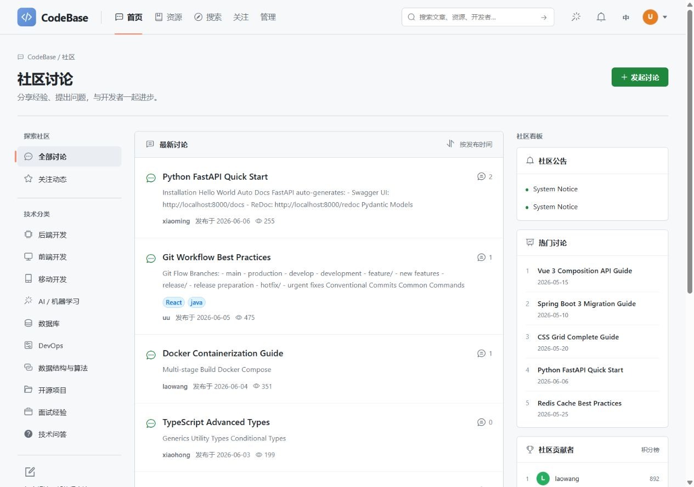
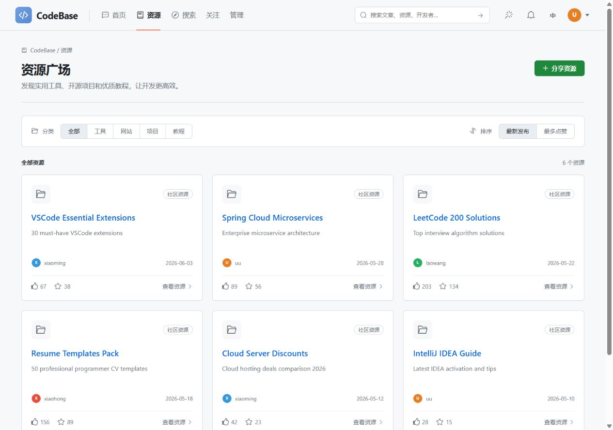
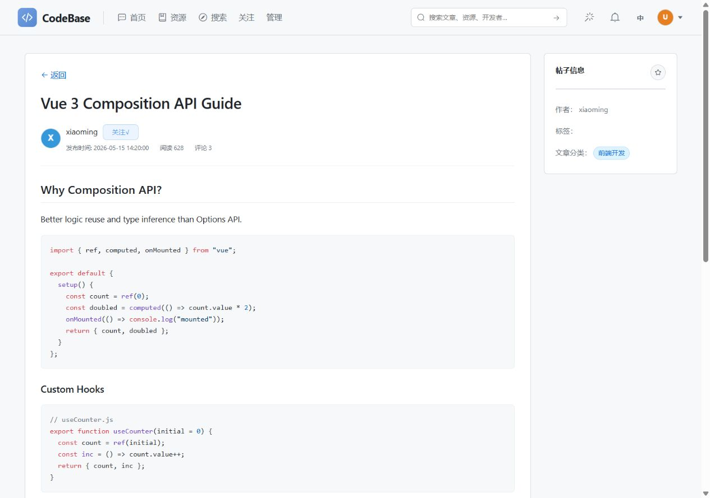
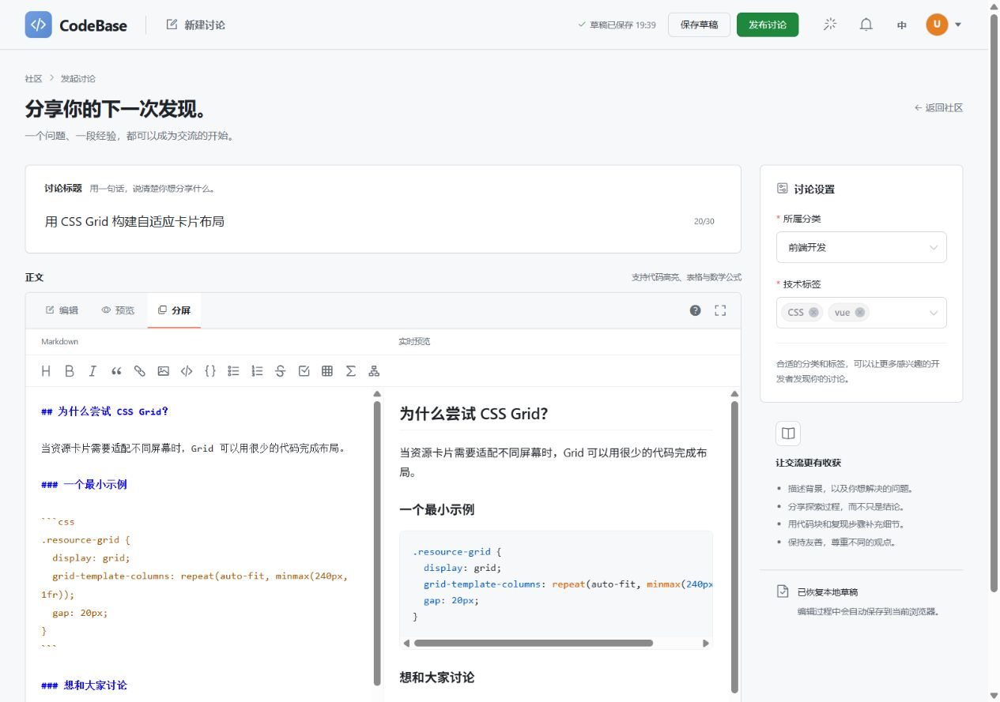
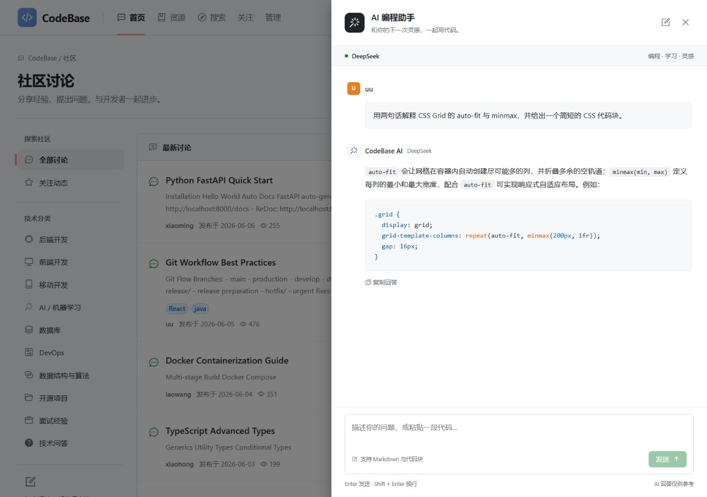
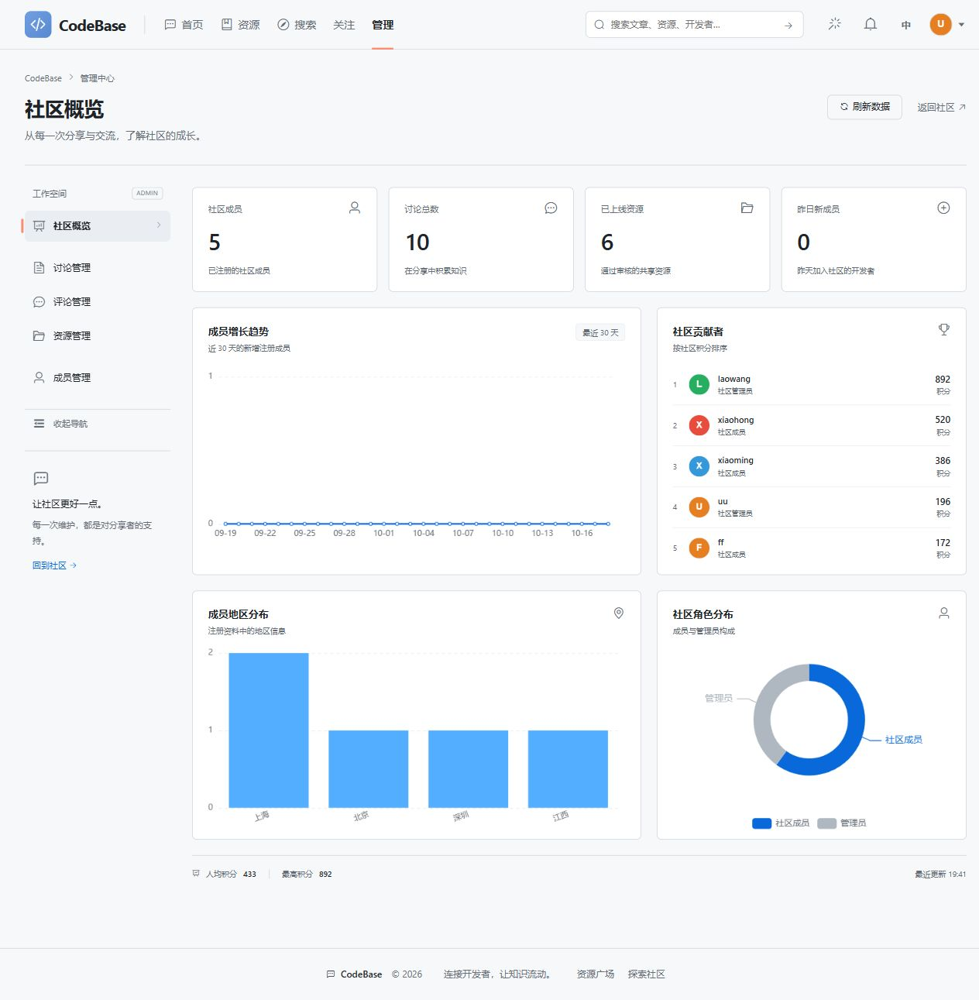

<p align="center">
  <h1 align="center">💬 CodeBase 编程社区</h1>
  <p align="center">一个面向程序员的轻量级技术论坛 —— 写作、分享、讨论、AI 辅助</p>
</p>

<p align="center">
  
  
  
  
  
  
  
</p>

---

## 📖 目录

- [项目简介](#项目简介)
- [功能特性](#功能特性)
- [技术栈](#技术栈)
- [项目结构](#项目结构)
- [快速开始](#快速开始)
- [配置说明](#配置说明)
- [页面展示](#页面展示)
- [迭代计划](#迭代计划)

---

## 项目简介

CodeBase 是一个专为程序员打造的技术社区平台，支持 Markdown 写作、代码高亮、**DeepSeek AI 对话**、资源分享等功能。用户可以发布技术文章、评论互动、收藏点赞，体验流畅的编程技术交流。

---

## 功能特性

### 📝 内容创作
- **ByteMD 编辑器** — 支持 GFM 表格、数学公式、Mermaid 图表、流程图
- **代码高亮** — Highlight.js 自动语法着色
- **图片上传** — 拖拽/粘贴上传，七牛云 OSS 托管
- **写作工作区** — 编辑 / 预览 / 桌面分屏、全屏编辑、Markdown 语法帮助和字数统计
- **本地草稿** — 自动保存与刷新恢复，分类和标签随草稿保留，发布前展示确认摘要

### 💬 社区互动
- 文章发布、编辑、删除
- 评论 / 回复（支持 Markdown + Emoji）
- 点赞、收藏、关注
- 资源分享（Source 模块）

### 🤖 AI 能力
- 集成 **DeepSeek** 大模型（原讯飞星火已替换）
- **SSE 流式响应** — 保留 Markdown 换行与代码缩进，实时呈现回答
- 支持快捷提问、停止生成、复制回答、新建对话与失败重试
- 使用 ByteMD 安全渲染 Markdown 与代码块

### 🔍 智能推荐
- 基于用户的**协同过滤推荐算法**（UserCF）
- 个性化首页内容推荐

### 🔔 实时通知
- WebSocket 实时消息推送
- 通知中心（铃铛下拉 + 独立页面）
- 未读计数 / 全部已读 / 单条删除

### 🛡️ 安全与风控
- **JWT** 登录认证
- **AOP + Redis** 接口权限校验、限流、防重复提交
- **前缀树（Trie）** 敏感词过滤
- GitHub OAuth 2.0 第三方登录

### 🖥️ 后台管理
- 成员管理 / 讨论管理 / 评论管理 / 资源审核，统一列表搜索、状态标签与操作样式
- 数据统计面板（ECharts）：成员与讨论数量、近 30 天成员增长、贡献者、地区和角色分布
- 可收起的桌面导航、手机端横向导航和表格区域滚动

### 🎨 视觉体验
- **简约 GitHub 风格** — 浅灰背景、白色面板、细边框，以及蓝色链接与绿色主要操作
- **统一主题** — 导航、讨论列表、资源、搜索、登录注册及管理界面共用配色与基础组件样式
- **响应式布局** — 桌面多栏、平板自适应、手机端折叠导航与社区看板抽屉
- **内容与交互状态** — Markdown 纯文本摘要、加载骨架、空状态、失败重试和键盘焦点提示

---

## 技术栈

| 层级 | 技术 | 版本 |
|------|------|------|
| **后端框架** | Spring Boot | 2.7.1 |
| **语言** | Java | 编译目标 1.8；本地运行已验证 JDK 17 |
| **ORM** | MyBatis-Plus | 3.4.1 |
| **数据库** | MySQL | 8.x |
| **缓存** | Redis | — |
| **搜索引擎** | Elasticsearch | — |
| **安全** | JWT + 自定义注解 | — |
| **AI 模型** | DeepSeek（SSE 流式） | — |
| **前端框架** | Vue | 2.6 |
| **UI 组件库** | Element UI | 2.15 |
| **状态管理** | Vuex | 3.6 |
| **路由** | Vue Router | 3.5 |
| **Markdown 编辑器** | ByteMD | 1.22 |
| **Markdown 渲染** | marked | 9.0 |
| **图表** | ECharts + v-charts | 4.9 |
| **构建工具** | Vue CLI | 5.0 |
| **CSS 预处理** | Sass（dart-sass） | 1.32 |

---

## 项目结构

```
forum-bs/
├── docs/images/                    # README 页面截图
├── forum-server/                   # 后端 Spring Boot
│   ├── src/main/java/com/example/
│   │   ├── annotation/             # 自定义注解（限流、权限）
│   │   ├── aop/                    # AOP 切面（日志、认证、限流）
│   │   ├── config/                 # 配置类（拦截器、MyBatis-Plus、WebSocket）
│   │   │   └── interceptor/        # JWT 拦截器
│   │   ├── constant/               # 常量 & 枚举
│   │   ├── controller/             # 控制器
│   │   │   ├── article/            # 文章相关
│   │   │   ├── chat/               # AI 对话（DeepSeek SSE 流式）
│   │   │   │   ├── client/         # DeepSeek 流式客户端
│   │   │   │   ├── config/         # AI 配置
│   │   │   │   └── dto/            # 消息 DTO
│   │   │   ├── source/             # 资源分享
│   │   │   ├── type/               # 分类 & 标签
│   │   │   └── user/               # 用户相关
│   │   ├── domain/                 # 实体类
│   │   │   ├── bo/                 # 业务对象
│   │   │   ├── dao/                # 数据访问对象
│   │   │   ├── dto/                # 数据传输对象
│   │   │   └── vo/                 # 视图对象
│   │   ├── exception/              # 全局异常处理
│   │   ├── filter/                 # 过滤器（敏感词）
│   │   ├── mapper/                 # MyBatis Mapper
│   │   ├── service/                # 业务层
│   │   │   └── impl/               # 业务实现
│   │   ├── utils/                  # 工具类（JWT、协同过滤）
│   │   └── websocket/              # WebSocket 通知推送
│   └── src/main/resources/
│       ├── application.yml         # 应用配置
│       └── mapper/                 # MyBatis XML
│
├── forum-client/                   # 前端 Vue 2
│   ├── src/
│   │   ├── api/                    # API 接口封装
│   │   ├── assets/                 # 静态资源
│   │   │   ├── css/                # theme.scss、markdown.scss、admin.scss
│   │   │   ├── data/               # 本地数据（表单验证规则）
│   │   │   ├── img/                # 图片
│   │   │   └── js/                 # WebSocket 客户端
│   │   ├── components/             # 公共组件
│   │   │   ├── admin/              # 后台管理组件
│   │   │   ├── aiModel/            # AI 对话（流式 SSE + Markdown）
│   │   │   ├── article/            # 文章/ByteMD 编辑器
│   │   │   ├── card/               # 卡片组件
│   │   │   ├── source/             # 资源详情
│   │   │   └── table/              # 表格
│   │   ├── mixins/                 # Vue 混入
│   │   ├── router/                 # 路由配置
│   │   ├── store/                  # Vuex 状态管理
│   │   ├── utils/                  # 内容摘要、SSE 流式事件解析
│   │   └── views/                  # 页面视图
│   ├── package.json
│   └── vue.config.js
│
└── ITERATION_PLAN.md
```

---

## 快速开始

### 环境要求

| 工具 | 版本 |
|------|------|
| JDK | 推荐 17（本地启动已验证；`pom.xml` 的编译目标仍为 1.8） |
| MySQL | 8.0+ |
| Redis | 5.0+（Windows 可用 Redis-x64） |
| Maven | 3.6+，安装后确保 `mvn` 可用 |
| Node.js | 18+ |
| npm | 10+ |

### 1. 克隆仓库

```bash
git clone https://github.com/zhouhw0306/forum-bs.git
cd forum-bs
```

### 2. 启动 MySQL、Redis 并初始化数据库

先启动 MySQL 和 Redis。Windows 上如果已注册为系统服务，可在**管理员 PowerShell** 中执行：

```powershell
Get-Service -Name MySQL80,Redis
Start-Service -Name MySQL80,Redis
```

服务名以实际安装结果为准；未注册为服务时，请通过本地安装方式启动。默认连接地址分别为 `localhost:3306` 和 `localhost:6379`。

首次运行时，在项目根目录打开 MySQL 客户端：

```bash
mysql -u root -p --default-character-set=utf8mb4
```

在 MySQL 客户端中执行：

```sql
CREATE DATABASE IF NOT EXISTS tp_forum CHARACTER SET utf8mb4;
USE tp_forum;
SOURCE forum-server/data/sql/tp_forum.sql;
EXIT;
```

导入脚本包含 `DROP TABLE IF EXISTS`，仅对需要初始化的开发库执行；已有数据时先备份，正常重启项目无需重复导入。

### 3. 配置并启动后端

修改 `forum-server/src/main/resources/application.yml` 中的数据库连接、用户名、密码及 Redis 配置。邮箱、七牛云、DeepSeek、GitHub OAuth 按需配置，对应功能需要有效凭证。

在项目根目录打开一个终端，使用 JDK 17 和 Maven 启动：

```bash
cd forum-server
mvn spring-boot:run
```

Windows PowerShell 如需切换 JDK，可在启动前设置当前终端的环境变量：

```powershell
$env:JAVA_HOME = 'C:\path\to\jdk-17'
$env:Path = "$env:JAVA_HOME\bin;$env:Path"
java -version
mvn -version
```

将示例路径替换为实际安装目录，并确认 `mvn -version` 使用 JDK 17，再执行 `mvn spring-boot:run`。环境变量只影响当前终端。

Maven Wrapper 文件目前被 `.gitignore` 排除，全新克隆后请使用已安装的 Maven；本地已有完整 Wrapper 文件时，也可执行 `./mvnw spring-boot:run`，Windows PowerShell 使用 `.\mvnw.cmd spring-boot:run`。

后端默认监听 `http://localhost:8888`。终端出现 `Started ForumServerApplication` 后，再启动前端。

### 4. 启动前端

在项目根目录另开一个终端，保持后端继续运行：

```bash
cd forum-client
npm ci
npm run serve
```

访问 [http://localhost:8087](http://localhost:8087)。默认开发端口在 `forum-client/vue.config.js` 的 `devServer.port` 中配置为 `8087`；端口被占用时，以终端实际输出为准。

前端默认请求本机 `http://localhost:8888`。更改后端地址时，需要同步调整 `src/api/http.js`、`src/store/configure.js`、`src/assets/js/websocket.js`，以及 `src/components/aiModel/AiModel.vue` 中的 AI 请求地址；这些路径均相对于 `forum-client`。

### 5. 构建前端

在 `forum-client` 目录执行：

```bash
npm run build
```

构建产物位于 `forum-client/dist/`。前端开发和主题样式说明见 [forum-client/README.md](./forum-client/README.md)。

---

## 配置说明

`application.yml` 关键配置：

| 配置项 | 说明 |
|--------|------|
| `spring.datasource` | MySQL 连接（默认 `tp_forum`，用户 `root`） |
| `spring.redis` | Redis 连接（默认 `localhost:6379`） |
| `spring.mail` | 邮箱服务（验证码发送） |
| `qiniu` | 七牛云 OSS（AccessKey / SecretKey / bucket） |
| `deepseek` | DeepSeek API（api-key / base-url / model / max-tokens） |
| `github` | GitHub OAuth App 凭证；前端回跳地址需与实际端口一致，本地默认为 `http://localhost:8087/login?type=github` |
| `elasticsearch` | ES 连接（默认关闭） |

> ⚠️ **安全提醒**：使用环境变量 `${ENV_VAR}` 注入敏感配置，避免密钥泄露。

---

## 页面展示

以下 6 张截图均来自本地运行的实际界面，可点击图片查看完整尺寸。编辑器中的示例仅保存为当前浏览器的本地草稿；AI 截图展示实际生成的回答。

| 社区首页 | 资源广场 |
|----------|----------|
|  |  |

| 文章详情 | 发起讨论 |
|----------|----------|
|  |  |

| AI 编程助手 | 管理端概览 |
|-------------|------------|
|  |  |

手机端通过“浏览分类”和“社区看板”访问社区侧栏；AI 助手适配全屏宽度，编辑器切换为单栏编辑 / 预览，管理导航和表格可在各自区域内横向滚动。

公共主题位于 `forum-client/src/assets/css/theme.scss`，Markdown 排版位于 `markdown.scss`，管理端公共样式位于 `admin.scss`。

---

## 迭代计划

详见 [ITERATION_PLAN.md](./ITERATION_PLAN.md)，核心路线：

```
Phase 1 (2026.Q3)  — 安全加固 & 体验优化
Phase 2 (2026.Q4)  — 架构升级（Spring Boot 3.x + Vue 3 + TS）
Phase 3 (2027.Q1)  — AI & 社区深化
Phase 4 (2027.Q2+) — 生态建设
```

### 近期更新（2026.10.18）

- ✅ 统一简约 GitHub 风格，更新导航、讨论列表、资源、搜索、登录注册及公共组件样式
- ✅ 移除粒子背景，采用浅灰页面背景、白色面板与细边框
- ✅ 完善手机端导航、分类展开、社区看板抽屉和资源卡片布局
- ✅ 增加加载、空状态和失败重试展示，统一 Markdown / HTML 纯文本摘要
- ✅ 修正路由切换后的滚动位置，保留浏览器前进 / 后退的滚动恢复
- ✅ 前端默认开发端口配置为 `8087`
- ✅ 重构 AI 对话抽屉，增加快捷提问、停止生成、复制回答与重试，修复 SSE 空白字符丢失导致的代码排版问题
- ✅ 重构讨论编辑器，支持分屏 / 预览 / 全屏、本地草稿自动保存与恢复，以及发布确认摘要
- ✅ 修复编辑 / 新建切换时的草稿归属问题，加载失败时保留草稿并暂停发布
- ✅ 重构管理端导航和真实数据看板，统一讨论、成员、评论及资源管理界面
- ✅ 优化关注页个人信息卡及手机端展示，统一蓝色品牌图标与标签页 favicon
- ✅ README 补齐社区首页、资源广场、文章详情、讨论编辑器、AI 助手和管理看板共 6 张实际截图
- ✅ 已验证公开页面在桌面及 320 / 390 / 768px 宽度下的布局，以及分类筛选、资源筛选、搜索跳转和登录表单校验；生产构建通过
- ✅ 已实测管理员页面筛选与文章预览、AI 流式回答、编辑器模式切换和草稿恢复，并检查 390px 手机布局；未提交示例讨论或执行管理数据变更

### 历史更新（2026.06）

- ✅ AI 模型从讯飞星火迁移到 **DeepSeek**，SSE 流式响应 + 打字机效果
- ✅ 通知中心完善：铃铛下拉 + 独立页面 + 实时推送
- ✅ 登录页居中布局与 SCSS 重构
- ✅ 个人中心 / 设置页 / 资源详情 UI 优化
- ✅ 全局响应式布局优化
- ✅ 代码块安全渲染（XSS 防护）

---

## 📄 License

MIT © [zhouhw0306](https://github.com/zhouhw0306)
